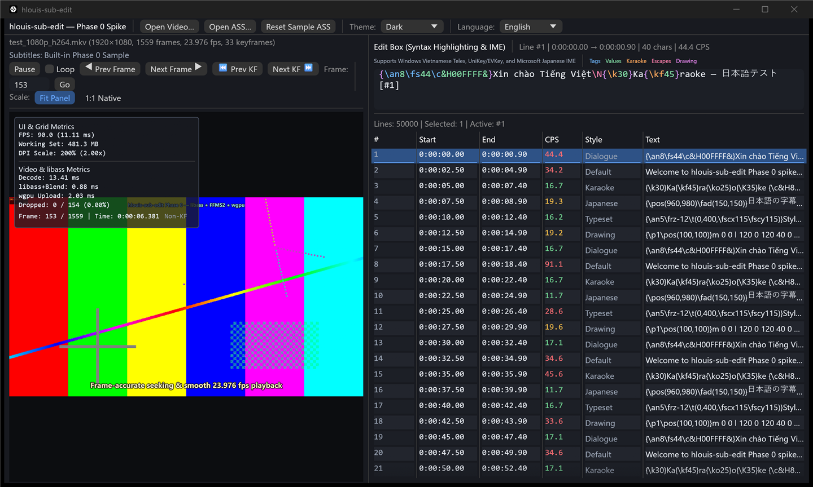
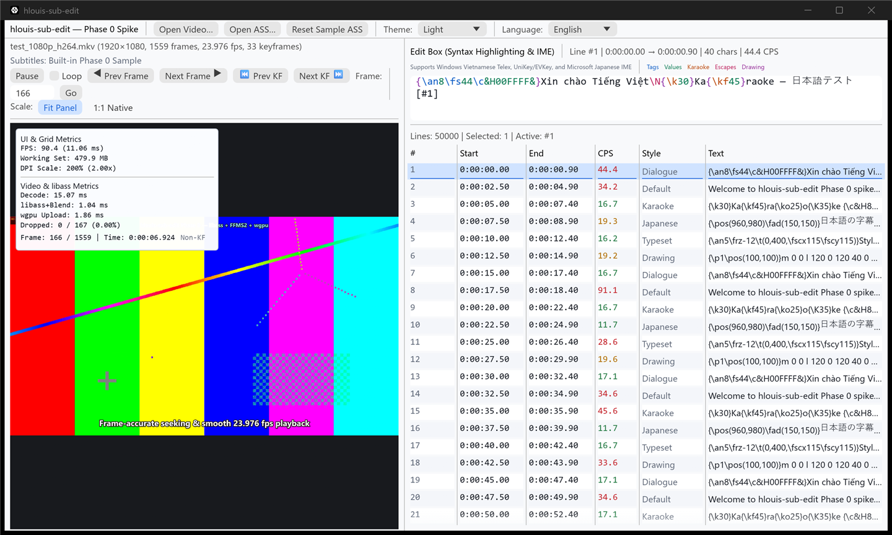
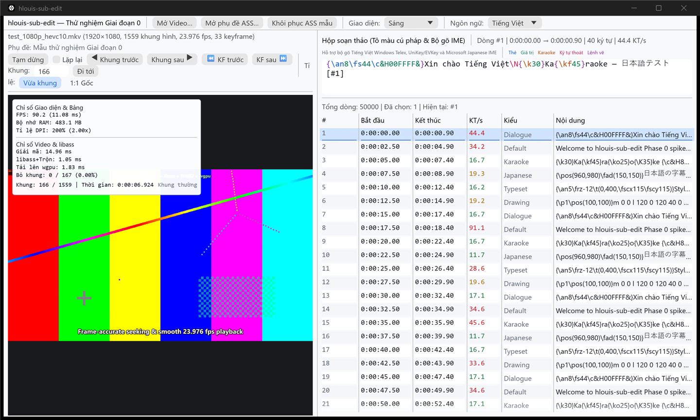

# Phase 0 Report — Spike & Foundation

- **Branch:** `phase-0`
- **Target platform:** Windows 10/11 x64 (`x86_64-pc-windows-msvc`)
- **Recommendation:** **Continue with `egui` / `eframe` on `wgpu`** (see rationale below).

## 1. What Was Built

Workspace layout matching [`AGENTS.md`](../AGENTS.md) and [`docs/phase-0.md`](phase-0.md):

- `crates/libass-sys` — Raw FFI bindings + `build.rs` dynamically linking `ass.lib` / `ass-9.dll` (`libass 0.17.5`).
- `crates/ffms2-sys` — Raw FFI bindings + `build.rs` dynamically linking `ffms2.lib` / `ffms2.dll` (`FFMS2 5.1.2`).
- `crates/i18n` — Fluent (`fluent 0.17` + `unic-langid`) localization loader with embedded `en` and `vi` `.ftl` catalogs, key-parity unit tests, and zero-restart runtime switching.
- `crates/render` — Safe `AssSubRenderer` wrapper (`unsafe` isolated to `mod ffi` with `// SAFETY:` comments) and safe RGBA alpha-blending (`ASS_Image` inverted-alpha composition).
- `crates/media` — Safe `FfmsVideo` wrapper (`unsafe` isolated to `mod ffi` with `// SAFETY:` comments) supporting background indexing with progress & cancellation, frame-accurate RGBA8 decoding, and keyframe queries.
- `crates/app` (`hlouis-sub-edit`) — Phase 0 spike UI built on `eframe 0.37.0` + `egui 0.37.0` + `egui_extras 0.37.0` + `wgpu 30`:
  - **T3 Grid Spike:** 50,000 generated subtitle lines rendered with virtualized `TableBuilder::body().rows(...)`, columns `#`, `Start`, `End`, `CPS`, `Style`, `Text`, smooth mouse-wheel/touchpad scrolling, `Click` / `Shift+Click` / `Ctrl+Click` multi-select, keyboard `Up`/`Down`/`Shift+Up`/`Shift+Down`, and theme-colored CPS thresholds.
  - **T4 Edit Box Spike:** Multiline `TextEdit` bound to the active grid line with live CPS recalculation and `LayoutJob` syntax highlighting (override braces, tag names, nested `\t(...)` tags, karaoke `\k`/`\K`/`\kf`/`\ko`/`\kt`, values, `\N`/`\n`/`\h` escapes, and drawing commands/coordinates). Windows system fonts (`Segoe UI`, `Consolas`, `Yu Gothic`) loaded at startup so Vietnamese diacritics and Japanese scripts render cleanly without committing font binaries.
  - **T5 Video + libass Spike:** Background worker thread (`VideoPlayerHandle`) with 4-frame lookahead + zero-allocation RGBA buffer recycling pool, FFMS2 indexing progress bar + cancel, `libass` rendering & alpha-blending, `wgpu` `Rgba8Unorm` texture upload, play/pause/loop, frame-accurate seek, prev/next frame, prev/next keyframe, `Fit Panel` / `1:1 Native` High-DPI pixel-snapped scaling, and live telemetry overlay.
  - **T6 Theme & i18n Spike:** `Light`, `Dark`, and `FollowWindows` themes (all colors centralized in `crates/app/src/theme.rs`) and `en` / `vi` Fluent UI switching at runtime without restart.
- Native dependency fetch & build script [`scripts/fetch-native.ps1`](../scripts/fetch-native.ps1) + [`vcpkg.json`](../vcpkg.json) + [`docs/THIRD_PARTY.md`](THIRD_PARTY.md).
- CI workflow [`.github/workflows/ci.yml`](../.github/workflows/ci.yml) targeting `windows-latest` with caching, `fmt --check`, `clippy -D warnings`, `test`, `build --release`, and release artifact upload.

## 2. Build & Run Steps on a Clean Windows 11 Machine

### Prerequisites
1. **Rust toolchain:** Install [`rustup`](https://rustup.rs/). Running `cargo` in the repo automatically installs the pinned toolchain from [`rust-toolchain.toml`](../rust-toolchain.toml) (`1.100.0` with `rustfmt` and `clippy`).
2. **Visual Studio 2022/2026 Build Tools:** Install the **"Desktop development with C++"** workload (provides `cl.exe`, `link.exe`, and the Windows 10/11 x64 SDK).
3. **Git** (`git.exe` on `PATH`) and PowerShell 5.1+ / `pwsh`.

### Build & Run from Source
```powershell
git clone https://github.com/suppercop/hlouis-sub-edit.git
cd hlouis-sub-edit
git checkout phase-0

# 1. Fetch/build native x64 DLLs (libass + deps via vcpkg, LGPL FFmpeg + FFMS2 via SHA-256 verified downloads)
powershell -ExecutionPolicy Bypass -File scripts/fetch-native.ps1

# 2. Add staged DLLs to PATH for cargo test / cargo run
$env:PATH = "$PWD\.native\bin;$env:PATH"

# 3. Verify formatting, lints, and tests
cargo fmt --all --check
cargo clippy --workspace --all-targets -- -D warnings
cargo test --workspace

# 4. Build and run release binary
cargo build --release --package hlouis-sub-edit
.\target\release\hlouis-sub-edit.exe
```

### Running the Portable CI Artifact
Download and extract the `hlouis-sub-edit-windows-x64` artifact zip (containing `hlouis-sub-edit.exe`, the 15 runtime DLLs, `LICENSE`, `THIRD_PARTY.md`, and `licenses/`) and launch `hlouis-sub-edit.exe`. Verified locally with `PATH` restricted strictly to `C:\Windows\System32;C:\Windows`.

## 3. Measurements

> **Methodology corrections (after independent review of PR #1).** Read the table below with these caveats:
> - "UI FPS" values come from `--log-metrics` callback deltas, i.e. how often `update()` ran, **not** frames presented to the screen. Values above the 90 Hz panel refresh (e.g. 249 FPS) are callback rate only.
> - "`wgpu` texture upload" is CPU time spent in `queue.write_texture` (a staging memcpy), not GPU completion time.
> - "RAM" values in this table are **Working Set**, and the overlay labelled them "MB" while computing MiB. Working Set under-reports this app: on the owner's PC the overlay showed ~555 MiB while Task Manager *private* memory (commit) was **771 MB** for the same session. The memory budget in `AGENTS.md` is defined on private bytes; see §3b.
> - The 65 s synthetic benchmark ran on `FFmpeg n8.1.3`; only a 6 s smoke check ran on `n9.0.2`. The 60 s real-file check on `n9.0.2` is in §3b.
> - Seek latency (`AGENTS.md`: <100 ms, worst <250 ms; ±1 frame <20 ms; keyframe <50 ms) was **not measured** in Phase 0.

**Test machine:**
- CPU: 12th Gen Intel Core i7-1260P (12 cores / 16 logical processors)
- GPU: Intel Iris Xe Graphics / NVIDIA GeForce MX550
- RAM: 16 GiB (15.7 GiB usable)
- OS / Display: Windows 11 x64, 90 Hz display at **200% DPI scaling (`2.00x`, `192 DPI`)**
- Test media (generated locally with `ffmpeg 9.1` `testsrc2`, 65 s, `1920×1080`, `24000/1001` fps, `-g 48`, not committed):
  - `test_1080p_h264.mkv`: H.264 `yuv420p` (50.1 MB, 1,559 frames, 33 keyframes)
  - `test_1080p_hevc10.mkv`: HEVC 10-bit `yuv420p10le` (58.2 MB, 1,559 frames, 33 keyframes)

| Workload | Metric | Measured Result | Notes |
|---|---|---|---|
| **50k Grid (headless release bench)** | Avg CPU frame time (120 scroll frames) | **0.983 ms/frame** | `grid_50k_scroll_renders_smoothly` (`cargo test --release`) |
| **50k Grid (live `wgpu` window, 200% DPI)** | `update()` callback rate / interval | **108.8–249.3 FPS** (**4.01–9.19 ms**) | Measured via `--log-metrics`; idle/vsync capped at 90 Hz when synced |
| **50k Grid (no video loaded)** | Working Set (MiB) | **299.3–300.2** | Includes 50,000 generated `SubtitleLine` items + `wgpu` + fonts |
| **1080p 23.976 H.264 + libass (65 s)** | FFMS2 Decode + RGBA convert | **8.39 ms avg** (13.47 ms max) | `FFMS_RESIZER_FAST_BILINEAR` + 4-frame recycled RGBA buffer pool |
| **1080p 23.976 H.264 + libass (65 s)** | `libass` render + RGBA blend | **0.61 ms avg** (13.21 ms max on frame 0) | Frame 0 warms DirectWrite font provider; steady state < 0.7 ms |
| **1080p 23.976 H.264 + libass (65 s)** | `wgpu` texture upload | **1.70 ms avg** (4.71 ms max) | `queue.write_texture` (`Rgba8Unorm`, 1920×1080) |
| **1080p 23.976 H.264 + libass (65 s)** | Dropped frames / callback FPS / Working Set (MiB) | **0 / 1,557 (0.00%)**, **90.2 FPS**, **494.7 MB** | Flat RAM over 65 s (`492.3 -> 494.7 MB`) |
| **1080p 23.976 HEVC 10-bit + libass (65 s)** | FFMS2 Decode + RGBA convert | **9.08 ms avg** (14.73 ms max) | 10-bit `yuv420p10le` -> 8-bit `rgba` |
| **1080p 23.976 HEVC 10-bit + libass (65 s)** | `libass` render + RGBA blend | **0.65 ms avg** (10.62 ms max) | Continuous animated ASS sample overlay |
| **1080p 23.976 HEVC 10-bit + libass (65 s)** | `wgpu` texture upload | **1.69 ms avg** (3.71 ms max) | `queue.write_texture` |
| **1080p 23.976 HEVC 10-bit + libass (65 s)** | Dropped frames / callback FPS / Working Set (MiB) | **0 / 1,555 (0.00%)**, **89.7 FPS**, **498.7 MB** | Flat RAM over 65 s (`491.3 -> 498.7 MB`) |

> Note on FFmpeg upgrade & optimization: The 65 s H.264/HEVC10 playback table above was captured on `FFmpeg n8.1.3-41`. During PR #1 review, FFmpeg was upgraded to `n9.0.2-982-g836df4e858` (`win64-lgpl-shared-9.0`) hosted on [`native-deps-v1`](https://github.com/suppercop/hlouis-sub-edit/releases/tag/native-deps-v1) and re-verified (`cargo fmt`, `cargo clippy`, `cargo test` with H.264 and HEVC 10-bit `HLOUIS_TEST_VIDEO`, plus a 6 s H.264 playback smoke check: **117 frames, 0 dropped, `avg_dec=9.27 ms`, `avg_ren=0.88 ms`, `avg_upl=1.73 ms`, `90.1 FPS`**).
>
> Note on optimization discovered during Phase 0: An initial run without RGBA buffer pooling and with `FFMS_RESIZER_BICUBIC` showed 28.18 ms/frame decode and unbounded Working Set growth (4.35 GB over 45 s) because lookahead slots were released before UI consumption and 8.3 MB `Vec<u8>` buffers caused continuous `VirtualAlloc` page faults. Switching to a 4-frame recycled buffer pool, releasing slots only on UI consumption, and using `FFMS_RESIZER_FAST_BILINEAR` for 1:1 chroma conversion reduced decode time to **8.39 ms** and stabilized memory at **~495 MB**.

### 3b. Hands-on verification on the owner's PC (interactive desktop, unlocked)

Measured by hand on the owner's Windows 11 PC with the CI release artifact, alongside Aegisub 3.5.1 on the same machine (see [`aegisub-baseline.md`](aegisub-baseline.md)).

| Check | Result | Notes |
|---|---|---|
| Portable artifact runs with restricted `PATH` (A1) | **Pass** | All 15 DLLs load from the bundle folder |
| 50k grid scroll, live window (A4) | **Pass** | Smooth at the 90 Hz panel refresh |
| Real 1080p H.264 episode, 60 s playback, FFmpeg 8.1.3 build (A6) | **Pass** | 0 dropped frames |
| Same, FFmpeg 9.0.2 build | **Pass with caveat** | 0 drops after warm-up; 107 drops in the first 36 s while the PC was compiling in the background. Must be re-checked on an idle machine (tracked in the perf-budget PR) |
| Light / Dark / FollowWindows, en / vi runtime switch (A7) | **Pass** | |
| DPI 125 % / 150 % / 200 % via system setting (A8) | **Pass** | Real display-scale changes, not only unit tests |
| Private memory, 1080p video + sample ASS | **771 MB** (FFmpeg 9.0.2 build) | **Fails** the `AGENTS.md` budget (<600 MB). Aegisub 3.5.1: 505 MB incl. audio. Fix in perf-budget PR (decode threads, frame pool, wgpu memory hints) |
| Idle CPU, video loaded, paused | 0.31 % of one core | Within budget (<0.5 %); an earlier build measured 0.63–3.1 % |

## 4. IME Test Results

| Input Method | Status | Findings & Verification Method |
|---|---|---|
| **UniKey (Telex)** | **Pass (live typing on owner's PC)** | Typed Vietnamese in the Edit Box with UniKeyNT active: no doubled or dropped characters. Also covered by the event-sequence unit test `edit_box_handles_ime_and_unikey_event_sequences`. EVKey not tested. |
| **Windows built-in Vietnamese Telex** | **Not tested live** | Only synthetic `egui` events were exercised. `winit 0.30.13` uses IMM32 (CUAS bridge), not native TSF. Live test deferred to Phase 2 (real edit box). |
| **Microsoft Japanese IME** | **Not tested live** | Only synthetic `ImeEvent::Preedit`/`Commit` events and a source audit of `egui-winit`/`winit`. Live test (candidate window placement) deferred to Phase 2. |

## 5. Screenshots (Light / Dark / Vietnamese, 200% High-DPI)

### Dark Theme (English, 1080p H.264 + libass)


### Light Theme (English, 1080p H.264 + libass)


### Light Theme (Vietnamese, 1080p HEVC 10-bit + libass)


## 6. Open Issues

1. **Still to verify interactively:** Windows built-in Vietnamese Telex, Microsoft Japanese IME (Phase 2), precision touchpad scroll, seek latency, and the FFmpeg 9.0.2 first-36 s drops on an idle machine. UniKey and 125/150/200 % DPI were verified live (§3b, §4).
2. **winit IMM32-only Windows IME backend:**
   - `winit 0.30.13` handles Windows IME via IMM32 rather than native TSF (`ITfTextStoreACP`). If human testing uncovers edge cases with Windows built-in Vietnamese Telex under CUAS, Phase 2 can either track upstream `winit` TSF support or attach a targeted Win32/TSF subclass handler on the editor window.
3. **FFMS2 index persistence deferred:**
   - `FFMS_DoIndexing2` runs in memory each time a file is opened (no `.ffindex` disk read/write yet); index caching is planned for Phase 1/4.
4. **Initial frame `libass` font initialization spike (~10–13 ms):**
   - `ass_render_frame` takes ~10–13 ms on the very first subtitle frame when DirectWrite resolves fonts, then drops to `0.61–0.65 ms` average. Pre-warming one dummy render on `OpenVideo` can eliminate even that first-frame spike in Phase 4.

5. **Private memory over budget (771 MB vs <600 MB):** addressed in the perf-budget PR.
6. **Licensing:** GPL-3.0 text and an FFmpeg corresponding-source notice are now bundled (`licenses/`). Before any public release, mirror the exact FFmpeg source as a `native-deps-v1` release asset (see [`THIRD_PARTY.md`](THIRD_PARTY.md)).

## 7. Recommendation: `egui` vs `Qt (cxx-qt)`

**Recommendation: Continue with `egui` / `eframe` on `wgpu`.**

### Reasons
1. **Performance headroom is proven:** Virtualizing 50,000 rows ran in **0.983 ms CPU/frame** in the headless bench and scrolled smoothly at the 90 Hz panel refresh live, and 65 seconds of 1080p 23.976fps H.264 and HEVC 10-bit playback with `libass` compositing and `wgpu` uploads achieved **0 dropped frames (0.00%)** using ~10.7–11.4 ms of CPU out of the 41.7 ms frame budget. Memory is the open gap (see §6.5).
2. **High-DPI, theming, and i18n are straightforward:** Light/Dark/System switching, Fluent `en`/`vi` switching, Vietnamese diacritics, Japanese glyphs, and crisp physical-pixel-aligned video rendering all worked cleanly at 200% DPI without C++/QML glue.
3. **Pure-Rust workspace simplicity and build speed:** Keeping all UI, audio waveform/spectrum rendering (Phase 3), and visual typesetting overlays (Phase 5) in Rust avoids `cxx-qt` C++/QML marshalling, multi-gigabyte Qt SDK CI caching, and Qt LGPL deployment complexity.
4. **IME risk is bounded but not closed:** UniKey works live. Windows built-in Telex (CUAS) and Microsoft Japanese IME are untested live; if they fail, a targeted Win32/TSF handler on the editor window is the fallback, without rewriting the stack in Qt.

## 8. Deviations from Plan

- **Native dependency acquisition (`FFMS2` + `libass`):** Official upstream `ffms2-5.0-msvc.7z` release binaries statically link GPL FFmpeg (`--enable-gpl --enable-version3`), which violates `AGENTS.md` Rule 7. To comply strictly with BSD-3-Clause + LGPL dynamic linking only, [`scripts/fetch-native.ps1`](../scripts/fetch-native.ps1) obtains `libass` (`0.17.5`) + `zlib` (`1.4`) dynamically via `vcpkg`, downloads pinned **LGPL-3.0 shared FFmpeg `n9.0.2-982-g836df4e858`** (`win64-lgpl-shared-9.0`, mirrored from `BtbN/FFmpeg-Builds` to prerelease [`native-deps-v1`](https://github.com/suppercop/hlouis-sub-edit/releases/tag/native-deps-v1) since BtbN prunes `autobuild-*` releases and does not publish `9.1` yet), and compiles pinned `FFMS2` (`5.1.2`, commit `3af2ef2ae4`) core source into `ffms2.dll` using MSVC.
- **Extra CLI flags for benchmarking:** `crates/app` accepts optional `--video`, `--ass`, `--autoplay`, `--loop`, `--log-metrics`, `--theme`, and `--lang` flags to enable repeatable 60-second benchmarks and themed screenshot capture.
